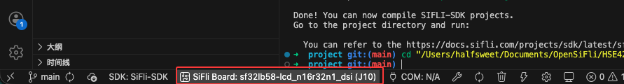
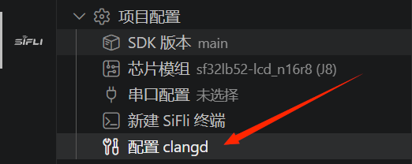

点击状态栏中的板子配置按钮，选择对应的开发板型号进行配置。



## 配置 clangd

如果需要使用 clangd 提供 C/C++ 代码补全、跳转和诊断，可以点击 VS Code 左侧活动栏中的 SiFli 图标，在 SiFli 侧边栏的 `项目配置` 中点击 `配置 clangd`。



CodeKit 会根据当前选择的芯片模组更新工作区的 `clangd.arguments`，将 `--compile-commands-dir` 指向当前工程的构建目录，例如：

```text
${workspaceFolder}/project/build_<芯片模组>_hcpu
```

同时，CodeKit 会在工作区根目录写入或更新 `.clangd` 文件，使 clangd 能够读取对应的编译数据库和 SiFli 工具链信息。

每次编译成功后，CodeKit 会自动完成上述配置：如果构建目录下已经生成 `compile_commands.json`，且配置与当前芯片模组不一致（例如第一次编译，或切换了芯片模组），CodeKit 会自动更新配置并重启 clangd，无需手动操作。如果不需要自动配置，可以在设置中关闭 `sifli-sdk-codekit.clangd.autoConfigureAfterBuild`。

也可以随时手动点击 `配置 clangd`。手动配置前请先完成一次正常编译，确保构建目录下已经生成 `compile_commands.json`，否则 CodeKit 会给出警告。配置有变化时，按提示点击 `重启 clangd` 即可生效。
